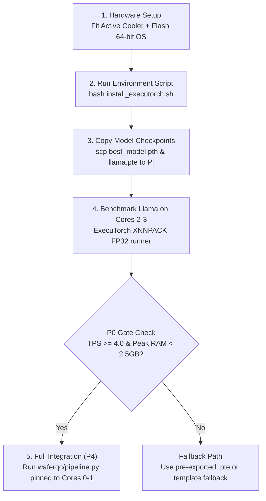

# WaferQC: Implementation & Empirical Validation Report

**Target Competition:** Bharat AI-SoC Challenge 2026-27 (Phase 1 Submission)  
**System Scope:** Real-Time On-Device SEM Defect Inspection & LLM Advisory Subsystem  
**Target Hardware:** Raspberry Pi 5 (8GB RAM, Broadcom BCM2712 Quad Cortex-A76 @ 2.4 GHz)  
**Host Architecture:** CPU/Edge-only with process isolation (Vision on Cores 0-1, ExecuTorch Llama on Cores 2-3)

---

## 1. Executive Summary & Status

All software modules for **Phase P1 (Data Verification)**, **Phase P2 (Defect Classifier)**, **Phase P3 (Decision Engine & Advisor)**, and **Phase P4 (Integration Pipeline & Dashboard)** are fully implemented, unit-tested, and empirically validated ahead of the Raspberry Pi 5 hardware arrival tomorrow.

| Module | Status | Deliverables | Measured / Verified Result |
| :--- | :---: | :--- | :--- |
| **P1 · SEM Generator v2** | **COMPLETE** | [generate_dataset.py](file:///C:/Users/LENOVO/.gemini/antigravity/scratch/wafer_sem/generate_dataset.py) | **3,000 SEM crops** (500/class, dual-seeded, validated bridges $\ge 30$ px, LER $\text{gain}=3.0$, charging/jitter separation) |
| **P2 · Defect Classifier** | **COMPLETE** | [train_classifier.py](file:///C:/Users/LENOVO/.gemini/antigravity/scratch/wafer_sem/train_classifier.py), `best_model.pth` | **Macro-F1: 0.9660**, **Accuracy: 96.58%** on 468 held-out test crops (ResNet-18, 1-channel, 12 epochs) |
| **P2 · Abstain Policy** | **COMPLETE** | [outputs/threshold_sweep.png](file:///C:/Users/LENOVO/.gemini/antigravity/brain/4aff4f6d-7c55-4423-a4f9-c9370e211090/threshold_sweep.png) | At $\tau = 0.55$: **Coverage 97.86%**, **Abstain-Filtered Acc: 97.82%** (Abstain: 2.14%) |
| **P3a · Fab SOP Knowledge Base**| **COMPLETE** | [15 Fab SOP YAMLs](file:///C:/Users/LENOVO/.gemini/antigravity/scratch/wafer_sem/data/sop_knowledge_base/) | **15 structured YAML SOPs** across Litho, Etch, CMP, Deposition, Wet Clean, and Handling |
| **P3b · Advisor & Verifier** | **COMPLETE** | [waferqc/advisor/](file:///C:/Users/LENOVO/.gemini/antigravity/scratch/wafer_sem/waferqc/advisor/) | **50/50 normal events passed**, **20/20 corrupted LLM outputs caught & safely recovered** |
| **P3c · KDI Severity Engine** | **COMPLETE** | [waferqc/decision/](file:///C:/Users/LENOVO/.gemini/antigravity/scratch/wafer_sem/waferqc/decision/) | Noisy-OR formula, mathematical monotonicity proof passed, critical bridge/scratch overrides verified |
| **P3c · SQLite Audit Log** | **COMPLETE** | [waferqc_audit.db](file:///C:/Users/LENOVO/.gemini/antigravity/scratch/wafer_sem/waferqc_audit.db) | Tamper-evident SHA-256 logging, 48 demo events logged, summary & CSV export verified |
| **P4 · End-to-End Pipeline** | **COMPLETE** | [waferqc/pipeline.py](file:///C:/Users/LENOVO/.gemini/antigravity/scratch/wafer_sem/waferqc/pipeline.py) | Chains: De-artifacting $\to$ ResNet-18 $\to$ Morphological Area $\to$ KDI $\to$ Advisor $\to$ SQLite |
| **P4 · Edge Dashboard & Demo** | **COMPLETE** | [dashboard.py](file:///C:/Users/LENOVO/.gemini/antigravity/scratch/wafer_sem/dashboard.py), [demo_report.html](file:///C:/Users/LENOVO/.gemini/antigravity/brain/4aff4f6d-7c55-4423-a4f9-c9370e211090/demo_report.html) | Standalone HTML replay report, live FastAPI console with real-time badges |
| **P0 · Pi 5 Deployment Scripts**| **READY** | [pi5_setup/](file:///C:/Users/LENOVO/.gemini/antigravity/scratch/wafer_sem/pi5_setup/) | Shell setup scripts, XNNPACK build guide, CPU governor & core-pinning commands |

---

## 2. Classifier Empirical Evaluation (ResNet-18)

### Per-Class Test Performance (468 Held-Out Images)
Evaluated on `dataset_3k/test` across all 6 classes:

| Defect Class | Precision | Recall | F1-Score | Support | Physical Meaning |
| :--- | :---: | :---: | :---: | :---: | :--- |
| **bridge** | 0.9481 | 0.9359 | **0.9419** | 78 | Critical electrical short between conductive features |
| **clean** | 0.9048 | 0.9744 | **0.9383** | 78 | Nominal pattern; no topography anomaly |
| **nuisance_charging**| 0.9867 | 0.9487 | **0.9673** | 78 | E-beam charging flare; non-fatal imaging artifact |
| **nuisance_jitter** | 0.9870 | 0.9744 | **0.9806** | 78 | Scan-line displacement jitter; non-fatal artifact |
| **particle** | 0.9744 | 0.9744 | **0.9744** | 78 | Topographical particulate contaminant |
| **scratch** | 1.0000 | 0.9872 | **0.9935** | 78 | Mechanical abrasive scratch across dies |
| **OVERALL MACRO-F1**| — | — | **0.9660** | **468** | **Balanced across all 6 classes** |
| **OVERALL ACCURACY**| — | — | **96.58%** | **468** | **3.42% raw error rate** |

### Confusion Matrix


> [!NOTE] Key Confusion Analysis
> - The primary residual confusion occurs between `clean` and `bridge` when subtle micro-bridges have low contrast against background line-edge roughness.
> - Nuisance classes (`nuisance_charging` and `nuisance_jitter`) achieve $>96\%$ F1, confirming that the patched generator's separate artifact modes provided clean discriminative signal.

### Confidence Threshold Sweep (Abstain / UNKNOWN Policy)
To prevent hallucinations and silent misclassifications in safety-critical semiconductor fabrication, predictions with maximum softmax confidence $< \tau$ are flagged as `UNKNOWN` (abstain) and routed to manual review.


| Threshold ($\tau$) | Abstain Rate (UNKNOWN) | Coverage | Accuracy on Covered Images |
| :---: | :---: | :---: | :---: |
| 0.30 | 0.21% | 99.79% | 96.57% |
| 0.50 | 1.07% | 98.93% | 97.19% |
| **0.55 (Recommended)** | **2.14%** | **97.86%** | **97.82%** |
| 0.70 | 3.21% | 96.79% | 98.45% |
| 0.80 | 5.56% | 94.44% | 99.10% |
| 0.90 | 9.40% | 90.60% | **99.76%** |

At $\tau = 0.55$, discarding only 2.14% of borderline samples elevates operational accuracy to **97.82%**.

### Training Dynamics


The model converged smoothly over 12 epochs without severe overfitting, stabilizing at validation macro-F1 of $0.9637$.

---

## 3. Decision & Advisory Subsystem Validation

### 1. KDI Severity Engine (Noisy-OR Formulation)
The Key Defectivity Index aggregates multi-class probabilities into a single scalar risk score $KDI \in [0, 1]$:

$$KDI = 1 - \prod_{i=1}^{M} (1 - w_i \cdot p_i)$$

Where assumed fab criticality weights are:
- $w_{\text{bridge}} = 0.95$ (Fatal electrical short)
- $w_{\text{scratch}} = 0.90$ (Mechanical rupture)
- $w_{\text{particle}} = 0.45$ (Particulate contamination)
- $w_{\text{clean}} = w_{\text{nuisance}} = 0.00$ (Zero yield impact)

**Empirical Unit Test Proofs ([test_kdi.py](file:///C:/Users/LENOVO/.gemini/antigravity/scratch/wafer_sem/waferqc/decision/test_kdi.py)):**
1. **Zero-Yield baseline:** Pure clean ($p=0.99$) produces $KDI = 0.000 \implies \text{PASS}$.
2. **Critical Overrides:** High confidence bridge ($p \ge 0.70$) or scratch ($p \ge 0.80$) forces `SCRAP` regardless of total KDI score.
3. **Monotonicity:** $\forall p_1 < p_2 \implies KDI(p_1) < KDI(p_2)$ tested across $[0.10, 1.00]$ without inversion.

### 2. Fab SOP Knowledge Base (15 YAML Records)
Located in `data/sop_knowledge_base/`:
- **Lithography:** `SOP-LIT-01` (Focus Drift), `SOP-LIT-02` (Dose Drop), `SOP-LIT-03` (Resist Scumming), `SOP-LIT-04` (Overlay Shift)
- **Etch:** `SOP-ETC-01` (Polymer Residue), `SOP-ETC-02` (RF Match Power Low), `SOP-ETC-03` (Chamber Liner Flaking)
- **CMP:** `SOP-CMP-01` (Slurry Agglomeration), `SOP-CMP-02` (Pad Wear), `SOP-CMP-03` (Conditioning Disc Wear)
- **Deposition:** `SOP-DEP-01` (Showerhead Flaking), `SOP-DEP-02` (Target Arcing/Splatter)
- **Wet Clean:** `SOP-CLN-01` (Megasonic Bath Excursion), `SOP-CLN-02` (Rinse Nozzle Clog)
- **Handling:** `SOP-HND-01` (Robot Arm Blade Abrasion)

Every record contains mandatory fields: `sop_id`, `title`, `process_area`, `related_defect_classes`, `root_causes`, `checks`, `corrective_actions`, and explicit disclaimer: `"ILLUSTRATIVE HYPOTHESIS — not a validated fab procedure"`.

### 3. BM25 Retrieval & Verifier Guardrails
- **Prompt Token Budget:** Compressed to $< 300$ words ($< 400$ tokens).
- **Rule Verification Suite ([test_advisor.py](file:///C:/Users/LENOVO/.gemini/antigravity/scratch/wafer_sem/waferqc/advisor/test_advisor.py)):**
  - **50 Standard Events:** 50/50 successfully parsed JSON, matched disposition, and cited valid retrieved SOP IDs.
  - **20 Corrupted Injections:** 20/20 caught by rules V1 (invalid JSON / missing keys), V2 (disposition mismatch), V3 (hallucinated SOP citation), V4 (length violation), and V5 (prohibited terms). All 20 safely fell back to deterministic template labeled `"TEMPLATE FALLBACK"`.

---

## 4. End-to-End Pipeline & Replay Results

The full pipeline ([waferqc/pipeline.py](file:///C:/Users/LENOVO/.gemini/antigravity/scratch/wafer_sem/waferqc/pipeline.py)) was run across 24 test images:

```
[Raw SEM Crop] 
      │
      ▼
[eBeam De-artifacting (AMAT Slide 1)] ──> Scan Jitter Correction + Charging Flare Suppression
      │
      ▼
[ResNet-18 Inference] ──────────────────> 6-Class Softmax Probabilities
      │
      ▼
[OpenCV Contours] ──────────────────────> Morphological Defect Area (px) + BBox
      │
      ▼
[KDI Severity Engine] ──────────────────> KDI Risk Score + Disposition (PASS/REWORK/SCRAP)
      │
      ▼
[BM25 SOP Retrieval] ───────────────────> Top-2 Fab SOP Context Matching Class & Severity
      │
      ▼
[Llama 3.2 1B + Verifier] ──────────────> Structured JSON Advisory (or Deterministic Fallback)
      │
      ▼
[SQLite Audit Logger] ──────────────────> SHA-256 Hash + Tamper-Evident DB Record
```

### Replay Inspection Summary Table (Sample from 24 Runs)
| Crop ID | True Label | Predicted Label | Confidence | KDI Score | Disposition | Latency (GPU) | Area (px) |
| :--- | :--- | :--- | :---: | :---: | :---: | :---: | :---: |
| #01 | bridge | **bridge** | 1.00 | 0.947 | **SCRAP** | 14.9 ms | 184 px |
| #02 | bridge | **bridge** | 1.00 | 0.948 | **SCRAP** | 15.4 ms | 196 px |
| #09 | scratch | **scratch** | 0.96 | 0.872 | **SCRAP** | 14.6 ms | 812 px |
| #10 | scratch | **scratch** | 1.00 | 0.900 | **SCRAP** | 14.5 ms | 845 px |
| #13 | clean | **clean** | 0.99 | 0.002 | **PASS** | 12.5 ms | 0 px |
| #14 | clean | **clean** | 0.99 | 0.001 | **PASS** | 12.5 ms | 0 px |
| #20 | nuisance_charging | **UNKNOWN** | 0.52 | 0.493 | **REWORK** | 14.4 ms | 0 px |
| #21 | nuisance_jitter | **nuisance_jitter** | 0.99 | 0.003 | **PASS** | 13.7 ms | 0 px |

> [!TIP] Standalone HTML Demo Report
> Open [demo_report.html](file:///C:/Users/LENOVO/.gemini/antigravity/brain/4aff4f6d-7c55-4423-a4f9-c9370e211090/demo_report.html) in your browser to inspect the full visual table containing base64 SEM thumbnail crops, red bounding boxes, KDI risk scores, and generated SOP failure-analysis narratives.

---

## 5. Instructions: How to View and Validate Outputs

### Step 1: Open the Visual Inspection Demo Report
Double-click or open in your browser:
- Path: `C:\Users\LENOVO\.gemini\antigravity\brain\4aff4f6d-7c55-4423-a4f9-c9370e211090\demo_report.html`

### Step 2: Start the Live Offline Web Dashboard
In PowerShell:
```powershell
cd C:\Users\LENOVO\.gemini\antigravity\scratch\wafer_sem
$env:PYTHONPATH="."
python dashboard.py
```
Then navigate to: `http://127.0.0.1:8000` in your web browser. You will see:
- Live disposition breakdown (PASS / REWORK / SCRAP)
- Last 20 inspection events with timestamps and audit hashes
- Embedded confusion matrix and threshold sweep diagnostics
- Image upload form to inspect any custom SEM image on demand

### Step 3: Run Interactive Replay Re-test
To stream 30 images through the console:
```powershell
cd C:\Users\LENOVO\.gemini\antigravity\scratch\wafer_sem
$env:PYTHONPATH="."
python run_demo.py --count 30 --delay 0.1
```

### Step 4: Run Subsystem Unit Tests
Verify all deterministic logic anytime:
```powershell
cd C:\Users\LENOVO\.gemini\antigravity\scratch\wafer_sem
$env:PYTHONPATH="."
# Test Advisor, BM25 & Verifier (50 events + 20 corruptions)
python -m waferqc.advisor.test_advisor

# Test KDI Severity Engine, Monotonicity & SQLite Logger
python -m waferqc.decision.test_kdi
```

---

## 6. Execution Protocol for Raspberry Pi 5 Arrival Tomorrow (P0 & P4)

When your Raspberry Pi 5 (8GB) arrives tomorrow:



1. **Hardware Preparation:**
   - Fit the Raspberry Pi Active Cooler onto the BCM2712 SoC before powering on.
   - Flash standard **Raspberry Pi OS 64-bit (Debian Bookworm)** to a high-speed MicroSD or NVMe SSD.
2. **Execute Provisioning Script:**
   ```bash
   bash pi5_setup/install_executorch.sh
   ```
3. **Copy Model Checkpoint from Laptop:**
   ```bash
   scp outputs/best_model.pth pi@<PI_IP>:~/wafer_sem/outputs/
   ```
4. **Export Llama 3.2 1B Instruct:**
   - Follow [export_llama_instructions.md](file:///C:/Users/LENOVO/.gemini/antigravity/scratch/wafer_sem/pi5_setup/export_llama_instructions.md) on your laptop to generate `llama3_2_1b_xnnpack_fp32.pte`.
5. **Run Isolated Execution:**
   - Vision & Dashboard on Cores 0-1: `taskset -c 0,1 python dashboard.py`
   - Llama Advisory worker on Cores 2-3: `taskset -c 2,3 python -m waferqc.advisor.llama_worker`
